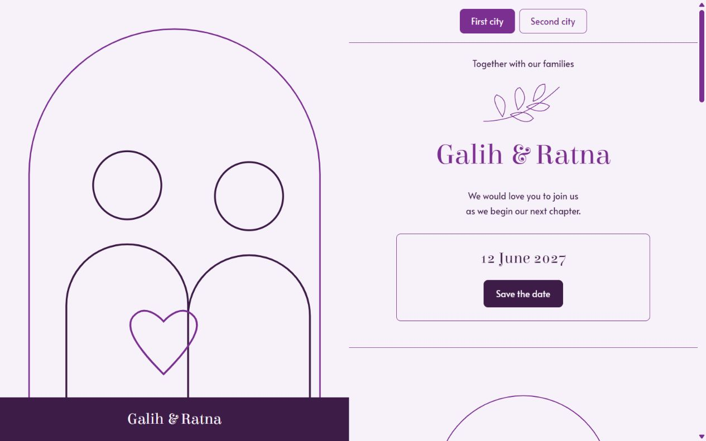

<div align="center">

# wed

**Hari bahagiamu. Websitemu sendiri.**

Template web undangan pernikahan gratis, memakai GitHub dan Cloudflare.

[Lihat contoh](https://wed.rezaprama.workers.dev) · [English](README.md) · [Panduan foto](docs/photos.md) · [Panduan lengkap](docs/setup.id.md)

[](https://deploy.workers.cloudflare.com/?url=https://github.com/rezaprama/wed)

</div>

Ganti nama. Masukkan foto. Bagikan tautan.

**Tanpa WordPress. Tanpa tema berbayar. Tanpa langganan template.** Versi awal tidak membutuhkan database, API key, atau terminal. Hosting bisa tetap Rp0 selama penggunaan berada dalam kuota Free Cloudflare. Kamu mendapat alamat `workers.dev` gratis. Domain sendiri boleh ditambahkan, tetapi tidak wajib.



<details><summary>Lihat contoh di ponsel</summary>


</details>

Demo contoh mendapat **100 pada empat kategori PageSpeed, untuk mobile dan desktop**, pada 20 Oktober 2026. [Laporan dan konteks pengukuran](docs/performance.md). Foto dan fitur tambahanmu bisa mengubah hasilnya.

## Cara pasang, pelan-pelan

1. **Buat salinan.** Klik tombol **Deploy to Cloudflare** di atas. Masuk memakai akun Cloudflare dan GitHub milikmu. Proses ini membuat repo di akunmu. Pilihan lain: klik [Use this template](https://github.com/rezaprama/wed/generate), lalu hubungkan salinannya melalui Cloudflare → Workers & Pages → Create application → Import a repository.
2. **Pasang contoh.** Nama repo boleh pendek apa saja, misalnya `nikah-kami`. Untuk pemasangan pertama, isi **Worker name** di Cloudflare dengan `wed`. Pilih paket Free. Isi Build command dengan `npm run build`. Isi Deploy command dengan `npm run deploy`. Pakai Node.js 24, atau isi `NODE_VERSION=24` bila diminta. Klik Deploy. Web contoh akan muncul. [Ingin nama Worker lain?](docs/setup.id.md#2-pasang-contoh-dulu)
3. **Ganti tulisan.** Di salinan repo GitHub milikmu, buka **`wedding.json`**. Klik ikon pensil. Ganti nama, tanggal, dan tempat. Jangan hapus tanda petik atau koma. Ubah `demo` menjadi `false`. Isi `language` dengan `"id"`. Klik **Commit changes**. Artinya, simpan perubahan.
4. **Masukkan foto.** Buka **`public/media`** → **Add file** → **Upload files**. Unggah `couple.jpg`, `person-one.jpg`, `person-two.jpg`, dan foto galeri. Di `wedding.json`, ganti alamat `.svg` dengan nama file barumu. Contoh: `"/media/couple.jpg"`. [Lihat foto mana masuk ke mana](docs/photos.md).
5. **Bagikan tautan.** Setiap perubahan disimpan, Cloudflare membuat ulang webnya. Salin alamat web yang sudah berhasil dibuka. Tambahkan `/send/` untuk membuat tautan per tamu. Contoh: `https://webmu.workers.dev/one/?to=Budi%20dan%20Keluarga`.

Sampai sini undangan sudah bisa dipakai. Musik, hadiah, dan buku tamu boleh ditambahkan nanti. [Panduan lengkap](docs/setup.id.md) membantu jika ada langkah yang tersangkut.

**Template aslinya tetap publik. Buat salinan milikmu privat sebelum mengunggah foto pribadi atau detail hadiah.** Repo privat menyembunyikan file sumber. Website yang dipublikasikan tetap dapat dilihat siapa pun yang punya tautannya. `allowIndexing: false` meminta mesin pencari tidak menampilkannya, bukan memberi kata sandi.

## Yang sudah tersedia

- Tampilan desktop dan ponsel: cover, profil pasangan, acara, peta, galeri, dan tombol simpan tanggal.
- Satu file pengaturan, **`wedding.json`**. Untuk mengganti isi biasa, kamu tidak perlu mengedit HTML atau JSX.
- Dua contoh kota dan dua kelompok pengundang. Huruf kecil untuk tamu pasangan. Huruf besar untuk tamu orang tua. Nama kode kota dapat diganti dan acara boleh dihapus.
- Halaman `/send/` untuk membuat tautan dengan nama tamu. Daftar nama diproses di browser, tidak diunggah ke server. Kamu sendiri yang memilih mengirim pesan WhatsApp.
- Musik lokal opsional. Mulai setelah undangan dibuka. Tombol yang sama menjeda dan memutarnya lagi. Tidak ada YouTube atau skrip pihak ketiga saat pertama memuat halaman.
- Detail hadiah dan tautan profil opsional. Pengaturan kosong tidak menghasilkan kartu kosong.
- Ucapan dengan persetujuan pengelola memakai Cloudflare D1, bila diaktifkan. Halaman `/admin/` dilindungi token. [Panduan buku tamu](docs/guestbook.id.md).
- Ilustrasi placeholder buatan proyek ini, font lokal berlisensi, serta foto yang otomatis dibuat WebP dan disesuaikan ukurannya.
- Dialog yang bisa dipakai lewat keyboard, dukungan reduced motion, dua font, tiga ukuran tulisan, dan tiga warna UI.
- Halaman 404, canonical sesuai alamat situsmu, pengaturan robots, dan sitemap.

Nama, keluarga, tanggal, dan tempat pada demo hanya contoh. Ilustrasinya bukan foto pasangan sungguhan. Ganti sebelum undangan dibagikan.

## Empat contoh tautan

| Acara | Tamu pasangan | Tamu orang tua |
| --- | --- | --- |
| Kota pertama | `/one/` | `/ONE/` |
| Kota kedua | `/two/` | `/TWO/` |

Halaman utama memakai acara pertama. Pindah kota tetap membawa nama tamu dan kelompok pengundang. Jika buku tamu diaktifkan, setiap varian punya daftar ucapan sendiri. Huruf besar dan kecil dibedakan.

## Gratisnya sampai mana?

Kode dan ilustrasi placeholder memakai **lisensi MIT**. Font memakai **SIL Open Font License** yang disertakan. Boleh dipakai, diubah, dan digunakan secara komersial dengan mengikuti lisensinya.

Cloudflare menyediakan paket Free untuk Workers dan D1 opsional. Kuota Workers saat ini mencakup 100.000 permintaan Worker per hari. D1 mencakup 5 juta baris dibaca dan 100.000 baris ditulis per hari, dengan penyimpanan total 5 GB. Kuota dibagi dalam akun, bukan hosting tanpa batas. Template ini menjalankan Worker untuk permintaan situs. Periksa [harga Workers](https://developers.cloudflare.com/workers/platform/pricing/), [harga D1](https://developers.cloudflare.com/d1/platform/pricing/), dan [batas paket GitHub](https://docs.github.com/en/billing/concepts/product-billing/github-actions) sebelum acara besar. Domain sendiri atau lisensi musik dapat memiliki biaya terpisah.

## Untuk yang memakai terminal

Gunakan Node.js 24 atau lebih baru.

```sh
npm ci
npm run dev
```

Buka `http://127.0.0.1:8788`. Preview membuat secret lokal dan SQLite lokal yang tidak masuk Git. Database produksi tidak dipakai. `npm run dev:cloudflare` memakai simulator resmi Wrangler.

```sh
npm run typegen
npm run check
npm run deploy:dry-run
npx wrangler login
npm run deploy
npm run smoke -- https://alamat-webmu.workers.dev
```

Versi awal tidak memerlukan secret. Gunakan integrasi GitHub di Cloudflare agar perubahan otomatis terpasang. GitHub Actions yang disertakan memeriksa kode tanpa memerlukan token deploy. [Arsitektur dan pengukuran performa](docs/performance.md).

## Bantu pasangan berikutnya

Ada masalah? [Buat issue](https://github.com/rezaprama/wed/issues/new/choose). Ingin membantu? Baca [CONTRIBUTING.md](CONTRIBUTING.md). Perbaikan kecil, petunjuk yang lebih mudah, dan tambahan bahasa sangat berguna.

Kalau wed membantu, star bisa membantu pasangan lain menemukannya. Bagikan hanya tangkapan layar yang memang boleh kamu publikasikan.
